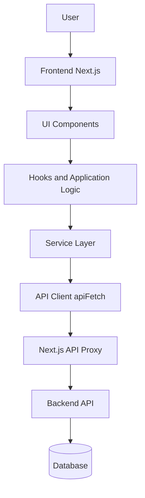

# Dokumentasi Arsitektur LogBook HRMS 2.0

## 1. Gambaran Umum Arsitektur

Sistem LogBook HRMS 2.0 pada sisi frontend menggunakan Next.js
sebagai framework utama, React sebagai library UI, dan TypeScript
sebagai bahasa pengembangan.

Frontend berkomunikasi dengan backend melalui HTTP API. Request
API dikelola melalui service layer yang berada pada folder
`src/services`, dengan `apiFetch` sebagai mekanisme komunikasi
terpusat.

Frontend menggunakan konfigurasi proxy Next.js untuk meneruskan
request `/api/*` menuju backend.

## 2. Diagram Komponen FE–BE–DB



Keterangan:

- User berinteraksi dengan aplikasi melalui frontend.
- UI Components menampilkan halaman dan komponen antarmuka.
- Hooks dan application logic menangani state serta interaksi aplikasi.
- Service Layer mengelola request API berdasarkan kebutuhan fitur.
- API Client mengelola komunikasi HTTP, error handling, timeout,
  request ID, dan credential.
- Next.js API Proxy meneruskan request API ke backend.
- Backend API mengelola proses bisnis dan akses data ke database.

Catatan: Komponen backend dan database pada diagram merupakan
gambaran integrasi sistem. Implementasi detail backend dan database
perlu dikonfirmasi dengan tim Backend.

## 3. Technology Stack

### Frontend

- Next.js 16.4.6
- React 19
- TypeScript 5.7
- Tailwind CSS 4
- Lucide React

### Testing

- Vitest
- Testing Library
- Playwright

### Development Tools

- Node.js
- npm
- ESLint 9
- Next.js App Router

## 4. Komunikasi Frontend dan Backend

Frontend melakukan komunikasi dengan backend menggunakan HTTP API
melalui service layer.

API Client yang digunakan adalah `src/services/apiClient.ts`.

Fungsi API Client meliputi:

- Mengirim request HTTP menggunakan Fetch API.
- Menyertakan credential pada request.
- Menangani timeout request.
- Menangani error HTTP dan network.
- Mengirim Request ID.
- Menangani response autentikasi.
- Menangani error response secara terpusat.

Konfigurasi proxy frontend:

```text
API_PROXY_TARGET=http://localhost:8080
```

Request dengan path `/api/:path*` diteruskan menuju backend
melalui konfigurasi rewrite pada `next.config.ts`.

## 5. Struktur Paket Frontend

```text
src/
├── app/
│   └── Halaman dan routing aplikasi Next.js
├── components/
│   └── Komponen UI dan fitur aplikasi
├── hooks/
│   └── Hook untuk state dan interaksi
├── lib/
│   └── Utility, validasi, timeline, dan logic pendukung
├── services/
│   └── Integrasi API dan pengelolaan request
├── types/
│   └── TypeScript type dan interface
└── proxy.ts
```

### Fungsi masing-masing paket

- `app`: Routing, halaman, dan struktur aplikasi menggunakan
  Next.js App Router.
- `components`: Komponen UI untuk membangun antarmuka aplikasi.
- `hooks`: Hook untuk pengelolaan state dan interaksi.
- `lib`: Utility dan logic pendukung aplikasi.
- `services`: Layer integrasi frontend dengan backend API.
- `types`: Type dan interface untuk data aplikasi.
- `proxy.ts`: Pengaturan akses navigasi frontend berdasarkan
  keberadaan session cookie.

## 6. Service Layer

Service layer digunakan untuk memisahkan logic komunikasi API
dari komponen UI.

Service yang telah teridentifikasi:

| Service                | Fungsi                                             |
| ---------------------- | -------------------------------------------------- |
| `authService.ts`       | Login, logout, user, roles, dan perubahan password |
| `dailyLogService.ts`   | Pengambilan data Daily Log                         |
| `taskService.ts`       | Pengelolaan Daily Log, Task, Calendar, dan submit  |
| `projectService.ts`    | Pengambilan data project                           |
| `teamService.ts`       | Pengambilan data team                              |
| `summaryService.ts`    | Pengambilan data summary                           |
| `settingsService.ts`   | Pengelolaan settings                               |
| `adminService.ts`      | Pengelolaan data admin                             |
| `masterDataService.ts` | Pengambilan master data task                       |
| `reviewService.ts`     | Pengelolaan review dengan mock implementation      |

Catatan: `reviewService.ts` masih menggunakan mock implementation
secara default dan belum sepenuhnya terintegrasi dengan endpoint
backend aktual.

## 7. Deployment dan Environment

### Local Development

Frontend dijalankan menggunakan Next.js development server.

```bash
npm install
npm run dev
```

Aplikasi dapat diakses melalui:

```text
http://localhost:3000
```

Backend API secara default dikonfigurasi menuju:

```text
http://localhost:8080
```

### Production Build

Proses build frontend:

```bash
npm run build
```

Menjalankan aplikasi dari hasil build:

```bash
npm run start
```

Detail infrastruktur deployment production, konfigurasi server,
database, container, dan CI/CD masih perlu dikonfirmasi dengan
tim Backend atau tim deployment.

## 8. Catatan Integrasi

Dokumentasi ini dibuat berdasarkan struktur repository frontend
dan konfigurasi yang telah diperiksa.

Informasi backend, database, dan deployment production yang
belum tersedia pada source frontend akan dikonfirmasi lebih lanjut
agar dokumentasi arsitektur sesuai dengan implementasi aktual.
